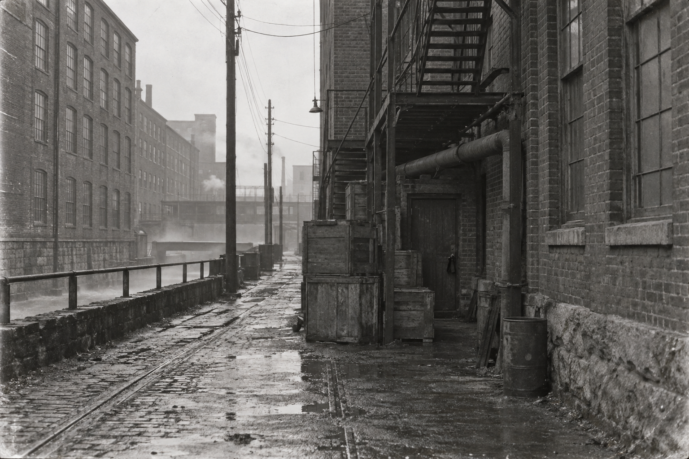
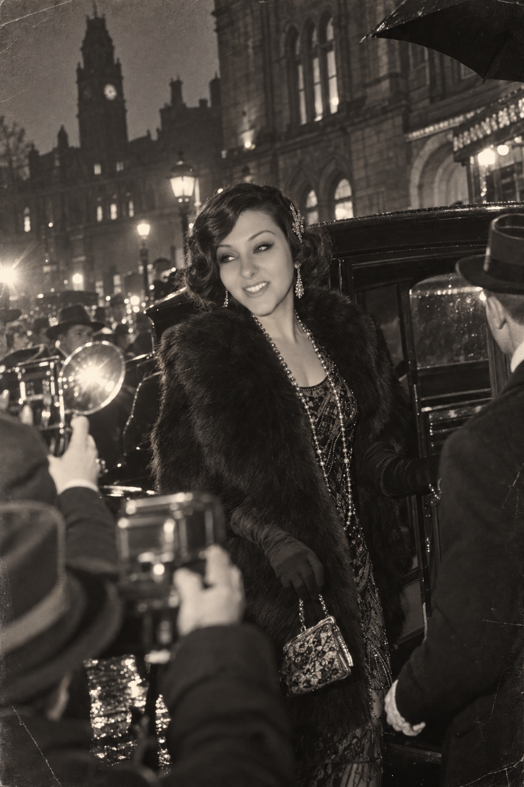
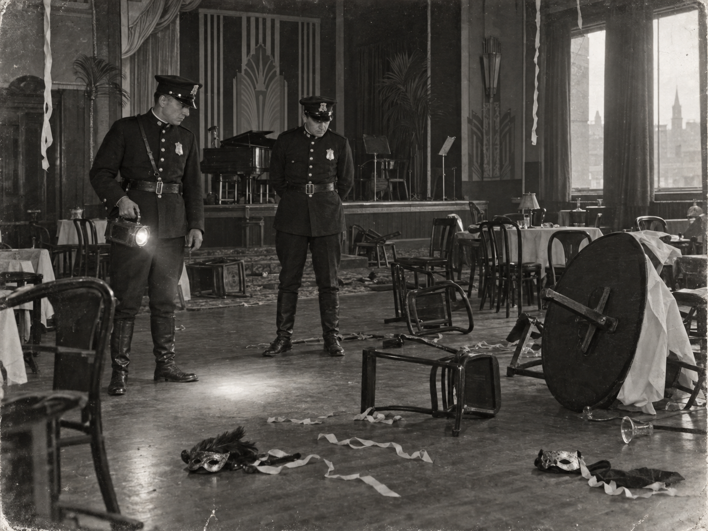
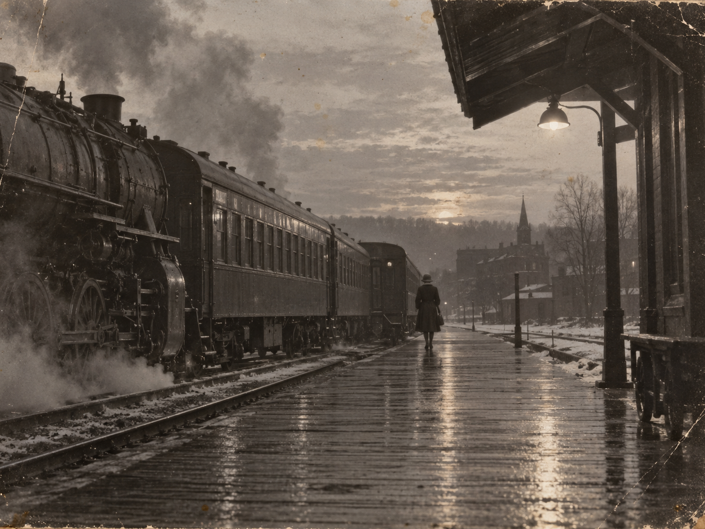

# File 245: every exhibit, in order

_Generated by `npm run case:docs` from `src/data/case/`. Do not edit by hand. **Contains the answers.**_

## Week 01 · Exhibit 245-01 · Nightmare on Summer Street

_Monday, November 1, 1926 · newspaper_ · The Courier's extra: the Keeper of a cellar club found dead behind a bolted door.

**The Boston Night Courier** · _EXTRA · Monday, November 1, 1926 · Two Cents_

### Nightmare on Summer Street

_Club Keeper Found Dead Behind Bolted Door at No. 245 · Every Light Fails at 11:47 · Guests Tell of a Veiled Woman · Police Padlock Cellar Before Dawn_

_By N. Shaw, of the Courier staff, who was present_

Christopher Kessler, thirty-eight, known to two hundred masked guests last night as Kit and to the rest of the city as nobody in particular, was found dead at two minutes before midnight in a locked office beneath the Hollis & Crane Leather Exchange, 245 Summer Street.

The office lies at the back of a cellar resort its patrons call The Black Toad, reached through the Exchange's freight lift and ten steps down. Last night the Toad held a masquerade. At 11:47 by the clock over the bar, every light in the place went out at once.

For about four minutes the cellar was dark. The band stopped. Somebody laughed. Then, guests say, the piano began again by itself: three notes, over and over, a tune the older members knew as the song of the woman who used to own the room.

When the lights came back, a woman in a black veil was walking the length of the floor toward the back of the house. No fewer than six guests saw her. None saw her face. None saw her leave.

At 11:58 the head barman, finding the office door bolted and his knock unanswered, forced it with a bar from the cellar. Mr. Kessler sat at his desk with a glass of rye beside him and a ledger open in front of him. He was dead. The mantel clock in the room had stopped. Its hands stood at 11:47.

Police under Capt. Ambrose Thayer reached the cellar at twenty past twelve. By one o'clock the captain had told this reporter the death “appears natural,” the guests had been sent up into Summer Street, and a padlock was on the freight lift. Asked why the office had been bolted from within, the captain said a man is entitled to lock his own door.

> **Two Years to the Minute**
>
> Older patrons of the Toad were quick to point out the hour. On All Hallows' Eve 1924, the club's last masquerade under its founder, Miss Cassandra Castello, ended in shots, screams and a cellar emptied into the street. That night, too, the music stopped at 11:47.
>
> Miss Castello was not seen again. Mr. Kessler, who kept her books, kept her club.

_The Fort Point Channel side of No. 245 at dawn. Courier photograph._

**Finding:** At what time did the lights fail at The Black Toad? _(As the Courier prints it. Hours and minutes.)_
**Accepted:** 11:47 · 11:47 pm · 11:47 p.m. · eleven forty seven · eleven forty-seven · 1147pm

**Work order WO-245-01 · Rejoin the split plate** (simulation not written yet)

Condition: Scanned from a water-stained copy. The plate split along the fold and the two halves were filed apart.

The Courier's extra reached the archive in two halves filed apart. Before anyone can read it whole, the restoration team needs a working setup they can all share, change and roll back. That is this sprint's simulation.

**Adds to “What the file says so far”:**

- On the night of October 31, 1926, a masquerade was held at The Black Toad, a club in the sub-cellar of 245 Summer Street.
- At 11:47 p.m. every light in the club failed for about four minutes.
- At 11:58 p.m. the club's Keeper, Kit Kessler, was found dead in his office, the Counting Room, behind a door bolted from the inside.
- Guests said a woman in a black veil crossed the room while the lights were out.
- Police padlocked the cellar before dawn.

## Week 02 · Exhibit 245-02 · Report of Death, Form 12

_November 1, 1926, 12:20 a.m. · report_ · The police report: a bolted door, a glass of rye, a stopped clock and a page cut from the ledger.

**Boston Police Department** · _Form 12 · Report of Death · Summer Street Station_

| | |
|---|---|
| Date and hour | November 1, 1926 · 12:20 a.m. |
| Place | 245 Summer Street, sub-cellar, rear office known as “the Counting Room” |
| Deceased | Christopher J. Kessler, aged 38, of ████████████████████ |
| Occupation | Manager of premises |
| Found by | Arthur Moss, barman, at 11:58 p.m., by forcing the door |
| Condition of door | Bolted on the inside. Bolt torn from the frame by forcing. |
| On the desk | One glass, rye whiskey, half full. One ledger, open, one page cut out with a blade (page no. ███). |
| In the room | Mantel clock, stopped, hands at 11:47. Wet marks on the floor leading from the ██████████████. |
| On the person | In the right hand, one brass tag, numbered (see attached). Wallet, $41. |
| Witnesses | None to the death. Guests dismissed 12:50 a.m. |
| Cause of death | Heart failure. No inquest required. |

> _(in the margin)_ Dr. Pratt asks to keep the glass. Refused. — A.T.

— Ambrose Thayer, Captain, Summer Street Station

**[STAMP: CLOSED · NOV 1 1926]**

**Finding:** Who signed the cause of death on Form 12? _(Surname is enough.)_
**Accepted:** Thayer · Ambrose Thayer · Capt. Thayer · Captain Thayer · Capt Ambrose Thayer · Captain Ambrose Thayer

**Work order WO-245-02 · Lift the faded carbon** (simulation not written yet)

Condition: Carbon copy. Lines of the original were blacked out by hand before filing, and the carbon has faded unevenly.

Form 12 is a carbon with lines blacked out by hand. Recovering what survives means building something that reads every line the same way, every time. That is this sprint's simulation.

**Adds to “What the file says so far”:**

- The police report lists a half glass of rye, a mantel clock stopped at 11:47, a ledger with one page cut out, and a brass tag in the dead man's hand.
- It records wet marks on the floor, though the word for where they led from is blacked out.
- Capt. Thayer signed the cause of death: heart failure, no inquest.
- A note in the margin says Dr. Pratt asked to keep the glass and was refused.

## Week 03 · Exhibit 245-03 · Miss Castello Receives

_Thursday, December 15, 1921 · clipping_ · A society column from 1921: a new supper club ten steps beneath Summer Street.

**The Boston Night Courier** · _Society · Thursday, December 15, 1921_

### Miss Castello Receives

_A New Supper Club Ten Steps Beneath Summer Street, and a Hostess Nobody Can Quite Place_

_Miss Castello arrives. Courier photograph._

Boston has acquired, this week, a hostess and a hiding place. The hostess is Miss Cassandra Castello, lately of New York, who wears her pearls long and her opinions longer. The hiding place is hers: a supper club in the deep cellar of the Hollis & Crane Leather Exchange, 245 Summer Street, reached by the freight lift and ten steps down.

Its emblem, painted on a green door, is a black toad caught mid-leap. Its rooms have names. The Lily Pad is the long room with the bandstand. The Well is the bar below the bar. Over that bar, carved into a beam of oak, are four words: LOOK BEFORE YOU LEAP. Miss Castello says they are the only rule that matters.

The accounts will be kept by Mr. C. Kessler, until lately a bookkeeper to the Exchange upstairs, who is said to remember every figure he has ever written down. Asked who has backed the venture, Miss Castello said only that her friends live in the North End and prefer to stay there.

Membership, we are told, is by card, and the cards are issued sixty at a time.

**Finding:** What words are carved over the bar at The Black Toad?
**Accepted:** Look before you leap

**Work order WO-245-03 · Separate paste from print** (simulation not written yet)

Condition: Clipped from the society page and pasted into a scrapbook. The paste has browned through the type.

The 1921 society column is half paste. The team has to tell what belongs to the page from what was added later, without damaging either. That is this sprint's simulation.

**Adds to “What the file says so far”:**

- The Black Toad opened in December 1921 under Miss Cassandra “Cassie” Castello, newly arrived from New York.
- Its emblem is a black toad caught mid-leap. Over the bar is carved: LOOK BEFORE YOU LEAP.
- Kit Kessler, once a bookkeeper at the Leather Exchange upstairs, came in to keep the club's accounts.
- Its money came from unnamed backers in the North End.

## Week 04 · Exhibit 245-04 · Member's Card No. 060, and a Matchbook

_c. 1922 · card_ · A member's card with the house rules on the back, and a matchbook naming the four rooms.

### The Black Toad

_Member's card · No. 060 of the Sixty · 245 Summer Street (ask for the freight lift)_

| | |
|---|---|
| Member | ██████████████████ |
| Admitted | March 1922 |
| Sponsored by | C. Castello |

---

### House Rules

|  | Rule |
|---|---|
| I | Knock once. Wait. Knock twice. |
| II | Ten steps down. Count them. |
| III | Masks are welcome. Names are not. |
| IV | The Counting Room is the Keeper's alone. |
| V | The Channel Door is for deliveries, and for no one else. |
| VI | Look before you leap. |

— C. Castello, Proprietress · countersigned K. Kessler, Keeper

---

> **Matchbook, found in the same envelope**
>
> THE BLACK TOAD · the Lily Pad · the Well · the Counting Room · the Channel Door
>
> Inside the cover, in pencil: “Channel Door → tunnel → Fort Point. Boats at half past, tide willing.”

**Finding:** According to the house rules, which room was the Keeper's alone?
**Accepted:** The Counting Room · Counting Room · Counting

**Work order WO-245-04 · Split the card, front from back** (simulation not written yet)

Condition: Photographed both sides in one pass. The front and back came out as one image and have to be separated and aligned.

Card No. 060 was captured front and back in a single image. Pulling the two apart, and keeping them matched, is this sprint's simulation.

**Adds to “What the file says so far”:**

- The Toad had four rooms: the Lily Pad, the Well, the Counting Room and the Channel Door.
- House rules: the Counting Room was the Keeper's alone; the Channel Door was for deliveries and no one else.
- The Channel Door opens on a tunnel to the Fort Point Channel, where boats could come and go unseen.
- To enter: knock once, wait, knock twice.

## Week 05 · Exhibit 245-05 · Terror at the Black Toad?

_Saturday, November 1, 1924 · newspaper_ · Two years earlier: shots at the 1924 masquerade, no bodies, and the founder gone.

**The Boston Night Courier** · _Saturday, November 1, 1924 · Two Cents_

### Terror at the Black Toad?

_Shots and Screams in Summer Street Cellar · Masked Guests Flee Into the Night · No Bodies Found · Proprietress Missing_

_The Lily Pad after the guests had fled. Courier photograph._

Something happened last night in the cellar of 245 Summer Street. What it was depends on whom you ask.

Guests at the All Hallows' masquerade of the club called The Black Toad say that at 11:47 the orchestra stopped mid-bar, the lights dropped, and shots were fired from the direction of the back rooms. Masked men and women poured up the freight lift and into Summer Street, some of them swearing they had seen bodies on the floor.

Police who went down at one o'clock found overturned chairs, a great many masks, and no bodies at all. Patrolman Joseph Healey showed this reporter a handkerchief he had pressed to a stain on the dance floor. The red came off on it like paint.

Of the club's proprietress, Miss Cassandra Castello, there is no sign. Her rooms upstairs are empty, her motorcar is in its garage, and her coat is on its hook. The club's bookkeeper, Mr. Christopher Kessler, met reporters at the freight lift at dawn. “Miss Castello has gone,” he said, “and the money with her. I am sorry for everyone she owed.”

> _(in the margin)_ Reopened April 1925. K.K. in charge. — clipping filed with File 245

**Finding:** Who told the Courier that Miss Castello had gone “and the money with her”? _(Surname is enough.)_
**Accepted:** Kessler · Kit Kessler · Christopher Kessler · Mr. Kessler · Kit · Christopher J. Kessler · C. Kessler

**Work order WO-245-05 · Re-expose the 1931 microfilm** (simulation not written yet)

Condition: Microfilmed in 1931 at the wrong exposure. The photograph is nearly black and the columns have drifted.

The 1924 front page was filmed at the wrong exposure and the columns drifted. Bringing it back takes a process that can be measured, checked and trusted. That is this sprint's simulation.

**Adds to “What the file says so far”:**

- On October 31, 1924, the Toad's masquerade ended in gunfire and panic. The music stopped at 11:47.
- Police found no bodies, only a red that came off on a handkerchief like paint.
- Cassie Castello vanished that night. Kit Kessler told the Courier she had gone, and the money with her.
- By spring 1925 the Toad had reopened with Kessler in charge.

## Week 06 · Exhibit 245-06 · Two Wires from Montreal

_October 24 and October 30, 1926 · wire_ · Two telegrams in the week before the murder: one to the Keeper, one to the coat room.

**Dominion Wire & Cable** · _Received at Boston · Two messages_

`MONTREAL QUE OCT 24 1926 · TO THE KEEPER 245 SUMMER ST BOSTON MASS`

    TWO YEARS ON STOP THE TOAD REMEMBERS STOP
    YOU KEPT THE BOOKS I KEPT THE KEY STOP
    ELEVEN FORTY SEVEN STOP
    C

`MONTREAL QUE OCT 30 1926 · TO B LORNE CARE OF COAT ROOM 245 SUMMER ST BOSTON MASS`

    ARRIVE NORTH STATION SUNDAY EVENING TRAIN STOP
    LEAVE THE CHANNEL DOOR ON THE LATCH STOP
    BRING NOTHING STOP

_The Montreal train at North Station. Undated; filed with the wires._

**Finding:** From which city were both wires sent?
**Accepted:** Montreal · Montréal · Montreal Quebec · Montreal, Que · Montreal QC

**Work order WO-245-06 · Put the wire strips back in order** (simulation not written yet)

Condition: Telegraph strips pasted onto backing card. Several strips lifted and were re-pasted out of order.

The Montreal telegrams were re-pasted out of order. Getting the messages back in sequence, with nothing lost and nothing doubled, is this sprint's simulation.

**Adds to “What the file says so far”:**

- A week before his death, Kit Kessler received a wire from Montreal: “You kept the books, I kept the key.” It was signed C.
- The day before the masquerade, a second wire from Montreal reached the coat room at 245 Summer Street, addressed to B. Lorne.
- The second wire announced an arrival at North Station on the evening train on Sunday, October 31.

## Week 07 · Exhibit 245-07 · The Keeper's Ledger, Page 244

_October 1926 · ledger_ · The page before the one that was cut out: who the Keeper paid, and who paid him.

**Ledger · K. Kessler** · _Page 244 · October 1926_

| Name | Paid | For |
|---|---|---|
| Capt. A.T. | $400.00 | quiet |
| Judge H.W. | $250.00 | papers |
| Lily Pad Seven (band) | $60.00 / wk | wages |
| Delvecchio | — | share held back, 3 mos. |
| Fogarty Bros. | owed $300.00 | Channel Door toll |
| N.S., Courier | $0.00 | refused |
| B.L., coat room | wages docked | knows about the key |

_Figures as written. “Paid” is what Kessler paid out._

> _(in the margin)_ Page 245: the names that matter. Keep it on me. — K.

**Finding:** Who received the largest payment in October 1926? _(As the ledger names them.)_
**Accepted:** Capt. A.T. · Capt AT · Captain A.T. · Thayer · Captain Thayer · Capt. Thayer · Ambrose Thayer · Captain Ambrose Thayer

**Work order WO-245-07 · Recover the skewed column** (simulation not written yet)

Condition: Bound ledger photographed open. The gutter is in shadow and the right-hand column is skewed off the frame.

The ledger's right-hand column runs off the frame. Reconstructing who paid whom means querying what survives and joining it back together. That is this sprint's simulation.

**Adds to “What the file says so far”:**

- Kit Kessler's ledger shows payments for silence. The largest in October 1926 went to “Capt. A.T.”
- He was holding back the North End backers' share and owed the Fogarty brothers money for the use of the Channel Door.
- He wrote that page 245 held “the names that matter” and that he kept it on him. That page was cut out on the night he died.

## Week 08 · Exhibit 245-08 · Memorandum, Not Filed

_November 1, 1926 · memo_ · The medical examiner's six minutes with the body, and why his notes never reached a file.

**Office of the Medical Examiner, Suffolk County** · _Memorandum · Not for filing_

| | |
|---|---|
| To | The File |
| From | L. Pratt, M.D. |
| Re | C. J. Kessler, 245 Summer Street |

I was admitted to the office at 1:10 a.m. and permitted six minutes with the body before it was removed on the captain's order.

A smell of bitter almonds at the mouth. Pupils wide. Lips and face flushed red. These are the signs of cyanide poisoning, and they are not the signs of a failing heart. A dose of that kind acts within minutes.

The barman Moss tells me the deceased's rye was poured at 11:40 from the house bottle, and that the deceased carried it to his office himself. I asked to keep the glass. It was taken by the captain's men before I could.

I have been told by Capt. Thayer that this memorandum will not be filed. I am writing it anyway.

— Lionel Pratt, M.D., Associate Medical Examiner

**Finding:** What poison does Dr. Pratt name?
**Accepted:** Cyanide · Prussic acid · Hydrogen cyanide · Potassium cyanide

**Work order WO-245-08 · Unfold the onionskin** (simulation not written yet)

Condition: Typed on onionskin and folded into eighths. The creases have worn through whole words.

Dr. Pratt's memorandum was folded until the creases ate the words. Restoring it means deciding who may handle it and proving each pass did no harm. That is this sprint's simulation.

**Adds to “What the file says so far”:**

- Dr. Pratt was given six minutes with the body. He smelled bitter almonds and saw flushed lips: signs of cyanide, not heart failure.
- He judged that the poison worked within minutes. The barman told him the rye was poured at 11:40.
- Capt. Thayer's men took the glass before the doctor could keep it, and the captain told him the memorandum would not be filed.

## Week 09 · Exhibit 245-09 · Shaw's Notebook: Five Statements

_November 1, 1926, 12:30 to 12:50 a.m. · notebook_ · The Courier reporter's notes from the twenty minutes before the guests were sent home.

**Notebook · N. Shaw** · _Taken in the Lily Pad, Nov. 1, 12:30–12:50 a.m. Not printed._

**Artie Moss** (head barman):

> “Poured his rye at twenty to twelve from the house bottle, same as every night. He took it back himself. He always did.”
>
> “When we got the door off, he had one of Bea's brass tags in his fist. Number 60. Had to open his fingers to read it.”

**Rudy Vance** (drummer, the Lily Pad Seven):

> “The lights didn't flicker. They went, like a hand on a switch. The fuse box is down the tunnel by the Channel Door. Everybody in the band knows that.”
>
> “The piano? Nobody was at the piano. I'd swear to it.”

**Bea Lorne** (coat room):

> “I never left the coat room. Ask anybody.”
>
> “Number 60 came back across my counter tonight with no coat to go with it. I put it on the hook and thought nothing of it. Then it was in his hand.”

**Tommy Fogarty** (harbor man):

> “Our boat was at the Channel Door at half past eleven. Six cases off, and we were back on the water by quarter to twelve. We never set foot past the tunnel.”

**Mrs. Philippa Cort** (guest):

> “She walked like Cassie. I knew Cassie. And when she passed me she smelled of the river.”

> _(in the margin)_ Thayer has taken the glass. Pratt is furious. — N.S.

**Finding:** What number was on the coat-check tag in the Keeper's hand?
**Accepted:** 60 · 060 · Sixty · No. 60 · Number 60 · #60

**Work order WO-245-09 · Re-collate the notebook** (simulation not written yet)

Condition: Pencil on cheap paper, smudged by a wet sleeve. Two pages were scanned twice and one not at all.

Shaw's pages were scanned twice, once, or not at all. Rebuilding the notebook so every statement appears exactly once is this sprint's simulation.

**Adds to “What the file says so far”:**

- The barman saw a coat-check tag, number 60, in the dead man's fist.
- The drummer says the fuse box sits by the tunnel to the Channel Door.
- B. Lorne says she never left the coat room, and that the tag in Kessler's hand had come back to her that night with no coat to match.
- The Fogarty boat unloaded at the Channel Door and says it left by 11:45.
- A guest says the veiled woman “walked like Cassie” and smelled of the river.

## Week 10 · Exhibit 245-10 · Order of Impoundment

_Tuesday, November 9, 1926 · order_ · The court order that sealed everything for a hundred years, and a note left in the box.

**Commonwealth of Massachusetts** · _Suffolk Superior Court · In re: the death of C. J. Kessler_

### Order of Impoundment

Upon the motion of the Police Commissioner, and the Court finding that publication would endanger the public order, it is ORDERED that every report, statement, photograph, ledger and paper of any kind touching the death of Christopher J. Kessler at 245 Summer Street be placed under seal, and be opened to no person, until the thirty-first day of October, in the year two thousand and twenty-six, one hundred years hence.

— Horace B. Whitcomb, Justice of the Superior Court · November 9, 1926

**[STAMP: IMPOUNDED]**

---

> **Slip found stuck to the back of the order**
>
> To whoever opens this box:
>
> The page is not in here. It never left the Toad.
>
> Look before you leap. — N.S.

**Finding:** Which judge signed the Order of Impoundment? _(Surname is enough.)_
**Accepted:** Whitcomb · Horace Whitcomb · Horace B. Whitcomb · Judge Whitcomb · Justice Whitcomb · Judge H.W.

**Work order WO-245-10 · Lift the slip without tearing the order** (simulation not written yet)

Condition: The last sheet in the box. Foxed, torn at the seal, and stuck to a second slip of paper that has to be lifted off without losing either.

The last sheet in the box is stuck to a second slip. Separating them safely, changing nothing that already works, is this sprint's simulation.

**Adds to “What the file says so far”:**

- On November 9, 1926, Judge Horace B. Whitcomb impounded every paper about Kessler's death until October 31, 2026.
- A note in the box, initialed N.S., says the missing ledger page never left the Toad.
- The file is open. Whoever reads it now knows more than the city was allowed to know in 1926.
